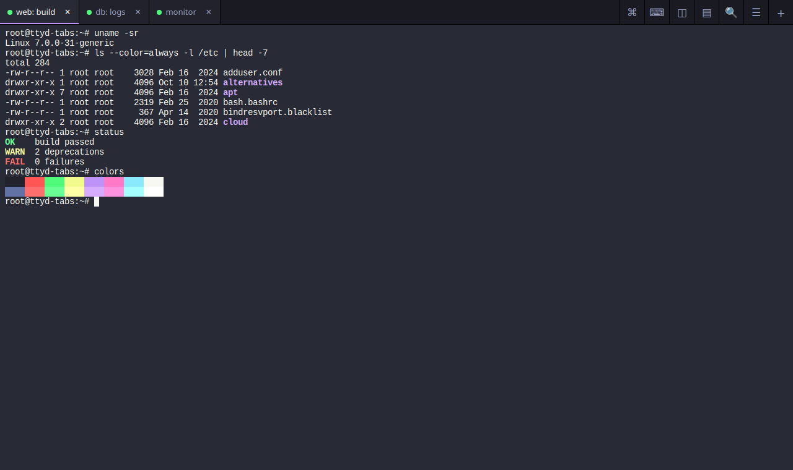
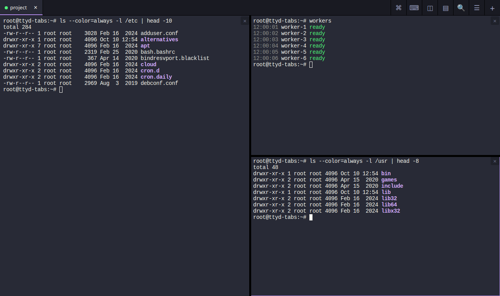
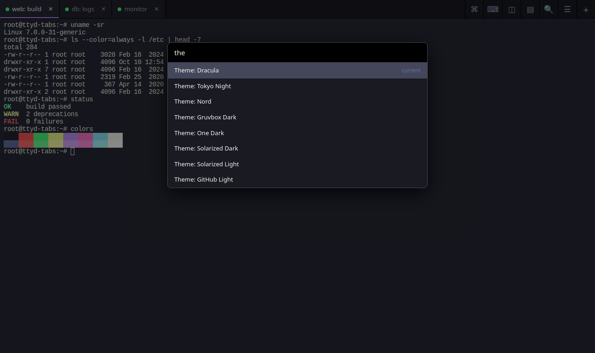
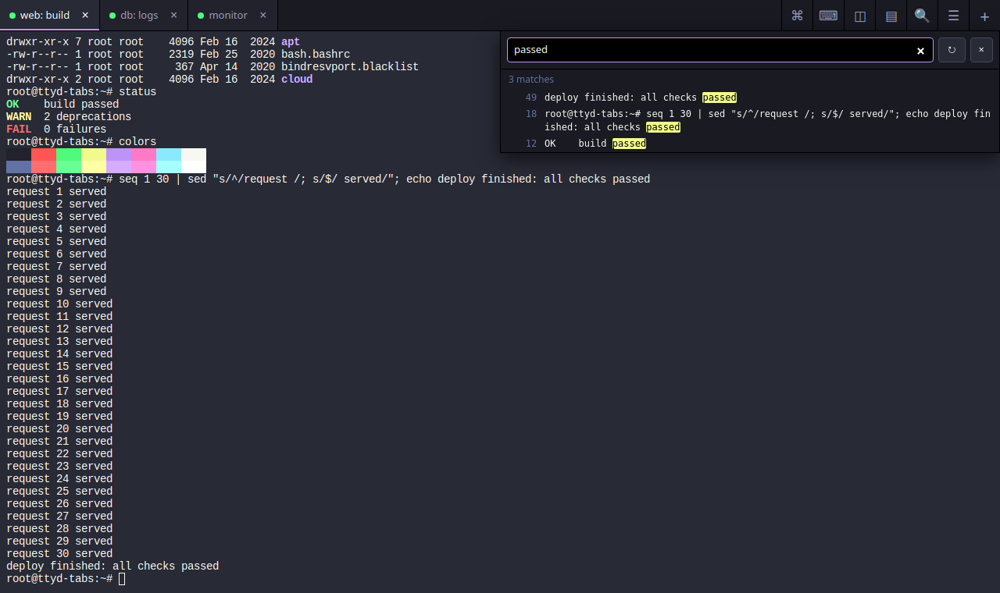
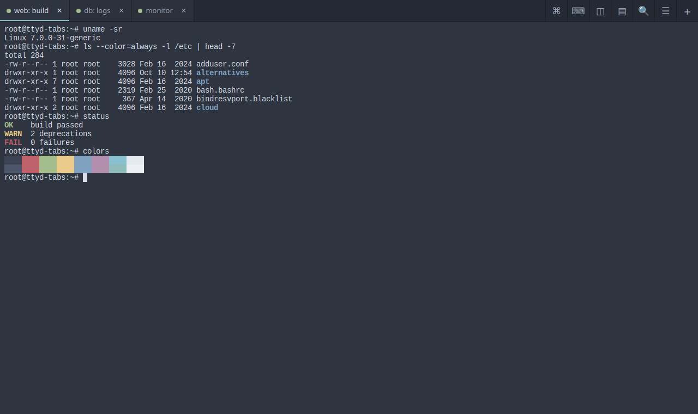
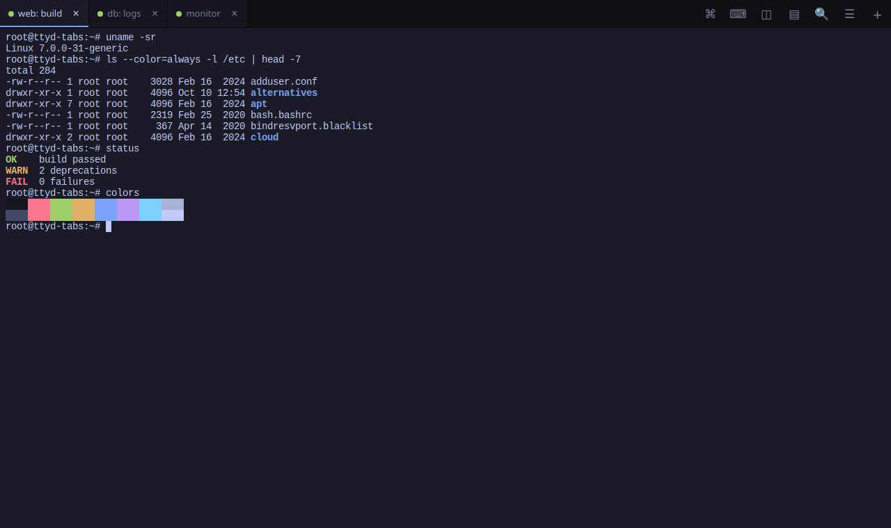
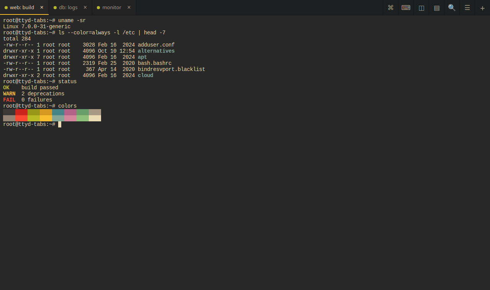
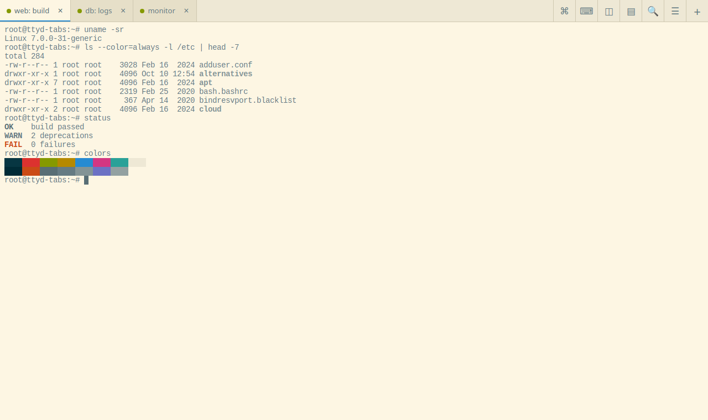
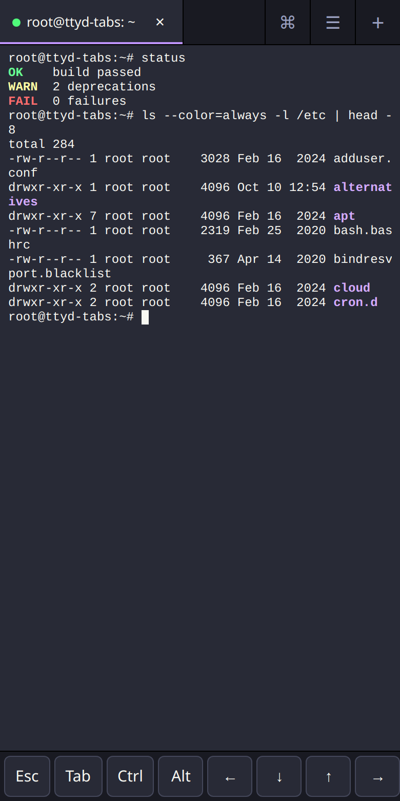

# ttyd-tabs

A multi-tab, persistent web terminal built on [ttyd](https://github.com/tsl0922/ttyd).

A proper terminal workspace that lives in your browser: tabs, split panes, a command palette, themes and search.
Close the page, lose your Wi-Fi or let your phone go to sleep, and your shells keep running, exactly where you left them.



Run it as a single Docker container, open it from your laptop, tablet or phone, and log in to your own machines over
SSH. It works the same on your home network, over Tailscale or behind your own domain, and it loads nothing from
third-party servers.

It is built on [ttyd](https://github.com/tsl0922/ttyd), the excellent tool that shares a terminal over the web. ttyd does
the heavy lifting; this project adds the everyday comforts around it. See [Credits](#credits).

## Features

- **Tabs**, each an independent shell with its own websocket. Rename them, jump with Alt+1..9, double-click the empty tab bar for a new one.
- **Persistent sessions.** Every tab is a tmux session inside the container. Reload, reconnect or switch devices and the tab reattaches to the same shell, same running programs. The tmux layer is invisible: no status bar, no prefix key.
- **Split panes** (up to 4 per tab), resizable by dragging the dividers, saved with the tab.
- **Command palette** (Alt+P): every action, saved hosts, open tabs and your own **snippets** in one searchable list.
- **Themes**: Dracula (default), Tokyo Night, Nord, Gruvbox Dark, One Dark, Solarized Dark and Light, GitHub Light. Terminal, page and scrollbars switch together; saved per browser.
- **Scrollback search** across the whole tmux history, with highlighted matches.
- **Saved hosts**: a `+` menu of SSH targets you define in a file. The browser only ever sends the key, never a command.
- **Touch key bar** for phones and tablets (Esc, Tab, Ctrl, Alt, arrows, `| ~ / \`...), one-shot Ctrl and Alt.
- **Broadcast input** to several tabs at once (Alt+B), with a clear red marker.
- **File transfer** with [trzsz](https://github.com/trzsz/trzsz) (`trz` / `tsz`) on desktop Chromium over https.
- Bell and new-output **badges** on background tabs, clickable links, copy on select, working paste (Ctrl+V and Ctrl+Shift+V), reconnect with backoff.
- All URLs are relative, so it works the same behind a domain, on a LAN IP, over Tailscale, or under a reverse-proxy sub-path.

### Split panes, search, palette



| Command palette | Scrollback search |
|---|---|
|  |  |

### Themes

| Nord | Tokyo Night |
|---|---|
|  |  |
| **Gruvbox Dark** | **Solarized Light** |
|  |  |

### On a phone



## Quick start

The default tab asks `login as:` and then opens an SSH session to the Docker host (`SSH_HOST`, default
`host.docker.internal`). So the host needs an SSH server, and the container needs to be able to reach it.

```sh
docker run -d --name ttyd-tabs \
  -p 127.0.0.1:7681:7681 \
  --add-host=host.docker.internal:host-gateway \
  ghcr.io/desoky725/ttyd-tabs:latest
```

Open <http://localhost:7681>, type your username, then your password at the SSH prompt.

- On Docker Desktop (Windows/macOS) `host.docker.internal` already exists; `--add-host` is harmless there.
- To connect somewhere else, add `-e SSH_HOST=nas.lan` (any host name or IP).
- `-p 127.0.0.1:7681:7681` publishes the port on this machine only. Read [Security](#security) before exposing it any wider.

### docker compose

```yaml
services:
  ttyd:
    image: ghcr.io/desoky725/ttyd-tabs:latest
    container_name: ttyd-tabs
    restart: unless-stopped
    ports:
      - "127.0.0.1:7681:7681"
    extra_hosts:
      - "host.docker.internal:host-gateway"
    environment:
      SSH_HOST: host.docker.internal
    volumes:
      - ./hosts.conf:/etc/ttyd-hosts:ro   # optional: saved hosts
      - ssh:/root/.ssh                    # optional: keeps known_hosts across restarts
volumes:
  ssh:
```

The same file is in [`docker-compose.example.yaml`](docker-compose.example.yaml). For a reverse proxy
with authentication, see [`docker-compose.traefik.example.yaml`](docker-compose.traefik.example.yaml) (a template, untested as shipped).

### Saved hosts

Create `hosts.conf` and mount it at `/etc/ttyd-hosts`. One line per host: `key | label | command`.

```
nas      | NAS            | ssh admin@nas.lan
pi       | Raspberry Pi   | ssh -p 2222 pi@192.168.1.50
```

A `+` menu then lists them next to the default login. Keys are `a-z 0-9 _ -` (max 32 characters). The browser sends only
the key; the server looks the command up in this file, so a client cannot run anything that is not listed. Edit the file and
reload the page; no restart is needed. See [`hosts.conf`](hosts.conf) for the format.

## Using it

| Action | Keys / UI |
|---|---|
| New tab | Alt+T, `+`, or double-click the empty tab bar |
| Close tab (ends its session) | Alt+W, or the `x` on the tab |
| Jump to tab N / previous / next | Alt+1..9 / Alt+Left / Alt+Right |
| Split pane right / down | Alt+\\ / Alt+- (max 4 panes) |
| Move between panes / close pane | Alt+Shift+Arrows / Alt+Shift+W |
| Command palette | Alt+P |
| Theme | Alt+P, then type `theme` |
| Search scrollback | Ctrl+Shift+F |
| Copy / paste | select to copy (or Ctrl+Shift+C) / Ctrl+V, Ctrl+Shift+V or right-click |
| Literal `^V` (shell quoted-insert, vim visual-block) | Ctrl+Alt+V |
| Broadcast to marked tabs | Alt+B marks or unmarks the tab |
| Sessions left on the server | the `=` button: Attach or Kill |

The tab dot is green when connected, amber when connecting and red when closed. Closing a tab ends its shell.
Closing the browser does not. Full details and the behaviours worth knowing are in [`ttyd-ui/README.md`](ttyd-ui/README.md).

## Security

ttyd-tabs has no login page of its own, so you decide who can reach it. That is easy to get right:

- **At home:** the examples publish the port on `127.0.0.1` only, so just your own machine can open it. To use it from your phone or laptop, connect through Tailscale or WireGuard and you're set.
- **On the internet:** put it behind a reverse proxy that handles sign-in (Traefik, Caddy, nginx, Authelia and so on) and use https. https also unlocks paste from the menu, clipboard sync and file transfer.
- **Your logins still apply.** The default tab asks for your SSH username and password, so the page alone doesn't open a shell on your machine.

Two things to keep in mind:

- Tabs that are already logged in stay open on the server, and anyone who can reach the page can reopen them. Share access only with people you trust.
- A saved host that logs in automatically (for example with an SSH key you mounted into the container) doesn't ask for a password, so keep those behind the sign-in too.

Under the hood the container only accepts a short, fixed list of requests (open, list, close a tab, search, saved hosts) and
ignores everything else. It runs nothing else and does not need the Docker socket.

## Limitations

- Sessions live in the container: recreating or upgrading it ends them. Tabs reconnect and start fresh shells.
- File transfer (trzsz) needs the browser's File System Access API (desktop Chromium over https or localhost). Downloading from an SSH host that is not running tmux is known to corrupt the file.
- Right-click paste and remote clipboard copy (OSC 52) need https; Ctrl+V and Ctrl+Shift+V work everywhere.
- tmux windows and panes are intentionally not exposed (splits are done by the UI), and there is no tmux prefix key.
- Alt+Left/Right and Alt+1..9 are taken by the page and do not reach the shell.

## Build from source

```sh
git clone https://github.com/desoky725/ttyd-tabs && cd ttyd-tabs
docker build -t ttyd-tabs .
```

The first build stage runs `node build.mjs`, which verifies the vendored libraries against `ttyd-ui/vendor/SHA256SUMS` and
inlines everything into one `index.html`. Node is only needed inside the build stage. The tests are browser-driven; see
[`ttyd-ui/TESTING.md`](ttyd-ui/TESTING.md) and `ttyd-ui/test/`.

Image tags: `latest` follows the newest release, and each release is also published as `1.2.3`-style version tags.

## Credits

This project exists because of **[ttyd](https://github.com/tsl0922/ttyd)** by Shuanglei Tao and its contributors: a
small, fast, rock-solid way to share a terminal over the web. The image is built on the unmodified official ttyd image,
and the whole UI plugs in through ttyd's own `-I` option. Thank you. ttyd-tabs is an independent project and is not
affiliated with or endorsed by the ttyd authors.

Also built on [xterm.js](https://github.com/xtermjs/xterm.js) (terminal rendering and its fit, WebGL and web-links addons),
[trzsz.js](https://github.com/trzsz/trzsz.js) (file transfer), [tmux](https://github.com/tmux/tmux) and OpenSSH.
See [`NOTICE`](NOTICE) for the licenses.

## License

[MIT](LICENSE)
